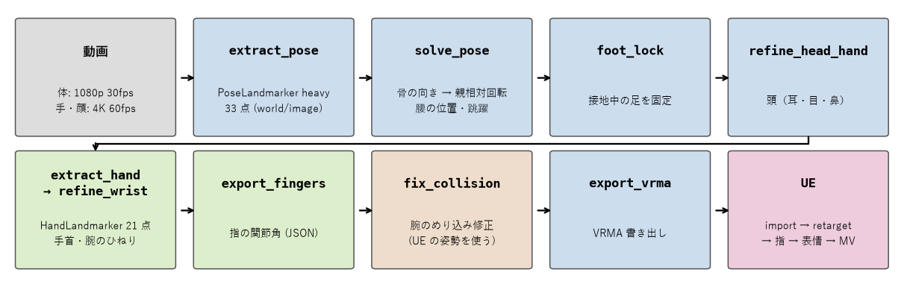
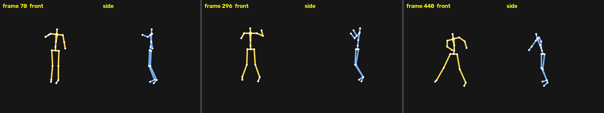
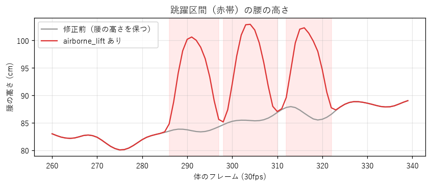

# 動画モーキャプ（MediaPipe → VRMA → UE）

単眼のダンス動画から MediaPipe で関節の点を取り、VRM の骨の回転に直して VRMA にし、UE のキャラを踊らせて MV にする工程。
2026-11-11〜12 に ILLIT「It's Me」の踊ってみた動画 1 本（571 フレーム・19 秒）で、Windows・UE 5.9・VRM4U を使って通した手順を抽出した。

スクリプトは本 repo に同梱しない。実体は非公開の制作 repo `eiei114/charakuru-dance-ue` の `scripts/dance/video2vrma/`（Python）と
`scripts/ue/`（UE Editor Python）にある。素材・キャラ・レンダー・取り出したモーションも含めない。

## 権利・gate

- 元動画は他人の踊ってみた動画、曲は市販曲だった。取り出したモーションと MV は**手元の制作用に限り**、公開・SNS 投稿・配布は別 gate。
  元動画の顔や体が写る確認画像も公開物に入れない（本書の図は棒人間とグラフだけ）。
- キャラの VRM は meta のライセンス（改変・再配布の可否）を先に読む。今回は改変不可のモデルに表情のモーフを足したコピーを作ったので、そのコピーも手元の制作用に限った。
- 動画の取得（`yt-dlp`）は download 工程なので、[着手手順](01-start.md)のホスト条件に従う。Mac mini で取得・推論・render をしない。

## 素材

- **体:** 全身が入った固定カメラの 1080p・30fps。
- **手と顔:** 同じ動画の 4K・60fps 版。1080p だと手が 60px ほどしかなく指が潰れる。`yt-dlp -F` で 4K/60fps を確かめ、`--download-sections` で区間だけ取る。
- **2 本の対応:** 体の i フレーム目 = 4K の OFFSET+STRIDE×i。体の動画に当たる 4K の範囲（crop）と合わせて、縮小フレームの突き合わせで決める。
- **撮影を選べる場合:** 手足を交差させない・体に沿った服・ミラー（反転）でない動画ほど楽。今回はミラー動画だったので、左右の確認（`check_mirror.py`）が要った。

モデルは MediaPipe Tasks の `pose_landmarker_heavy.task`、`hand_landmarker.task`、`face_landmarker.task`。

## 工程

| 段 | スクリプト | やること |
|---|---|---|
| 1 | `extract_pose.py` | 体 33 点（world: 腰中心・m、image: 画面座標、visibility）。571 フレームで約 1 分 |
| 2 | `solve_pose.py` → `foot_lock.py` | 点から骨の向き → VRM rest からの親相対回転。腰の位置は接地から、跳躍は画面上の腰の上がりから復元 |
| 3 | `refine_head_hand.py` | 頭を耳・目・鼻から作り直す。肩・目の線を画面の傾きに合わせる |
| 4 | `extract_hand.py` → `refine_wrist.py` → `export_fingers.py` | 4K から手を切り抜き、元と左右反転の 2 回推論。手首と腕のひねり、指の関節角 |
| 5 | `export_vrma.py` → UE | VRMA → `import_vrma` → `retarget_dance` → `apply_fingers` → `dump_anim_pose` |
| 6 | `check_collision.py` / `fix_collision.py` | UE の姿勢でキャラのメッシュを変形して腕のめり込みを測り、肩・肘を外へずらす。直したら 5 をもう一度 |
| 7 | `extract_face.py` → `build_mv.py` → `export_face.py` → `apply_face.py` | 顔のブレンドシェイプを表情に、目線は MV のカメラへ |
| 8 | `render.py` → ffmpeg | MRQ の PNG 連番 → BGM と合わせて MP4。検品は [05-qa](05-qa.md) |

## 単眼で取れないものと補い方

| 取れないもの | 補い方 |
|---|---|
| 体のワールド位置・跳躍（world は腰が原点） | 接地中の足をワールドに固定して腰を決める。両足が画面上で 6 cm 以上浮いた区間に、画面上の腰の上がりを足す（5 cm 未満は跳躍としない） |
| 腕の軸まわりのひねり | 肘を曲げている間は上腕を肘の曲げ面にそろえる。まっすぐな間は前後の曲げているフレームの値をつなぐ。残りは前腕と手首で半分ずつ |
| 着地などで 1〜2 フレーム崩れる奥行き | 手足の骨ベクトルの奥行きが前後 7 フレームの中央値から 8 cm 以上外れたフレームだけ、前後からつなぐ |
| 体を横切る線の傾き（3D が画面と 14〜22° ずれる） | 胸は肩の線、頭は目の線を画面の傾きに合わせる |
| 掌の表裏（掌の 5 点がほぼ平面） | 2 回推論した候補から、前後とのつながりが滑らかな経路を動的計画法で選ぶ。推論が割れる区間ほど強く平滑化 |
| 両手が近いときの手 | 片方の切り抜きが反対の手を拾うので、検出した手首が反対側の体の手首に近い推論を捨てる |

## 確認

UE に入れる前と後で同じ指標を見る。リターゲットで手首の誤差は増えなかった。

- `viz_solved.py`: 元動画と正面・横の棒人間を並べる。
- `check_slide.py`: 接地中の足の滑り（cm）。`check_mirror.py`: 左右の取り違え。
- `check_hands.py`: 元と左右反転の推論が 20° 以内で一致したフレームだけを正解として、手の向き・指のずれを測る。
- `hand_overlay.py`: 元動画の手にキャラの手の骨を重ねる。レンダーの画質に関係なく形を比べられる。
- `check_collision.py`: 腕・手のめり込み（1 cm 超・3 cm 超の割合と最大）。

## 実測（It's Me、UE 上のアニメで測定）

| 指標 | 値 |
|---|---|
| 手の向きのずれ（推論が揃ったフレーム、左 / 右の平均） | 約 16° / 15° |
| めり込み 3 cm 超 | 0% / 0%（最大 2.6 / 0.8 cm） |
| 跳躍の腰の最高点 | 立った位置から +18 cm |
| 上腕が 1 フレームに 15° 超回るフレーム（左 / 右） | 19 / 14 |

1 本の動画での値で、別の動画・別のキャラでは未検証（Unverified）。

## 残る限界

- 顔の前で手が速く動く区間は、指の推論が大きく飛ぶ。詰めるなら HaMeR / WiLoR などの 3D 手形状モデルに替える。
- 手の推論が割れる区間では、手首が短時間に大きく回ることがある（2 フレームで 75° の例が 1 か所）。
- 腿の軸回転と足首から先のロールは最小回転の近似。
- めり込み修正は UE を往復する（修正前の姿勢を書き出して測る）。手首だけ作り直すときは修正量を移す `reapply_collision.py` で 1 往復に減らせる。
